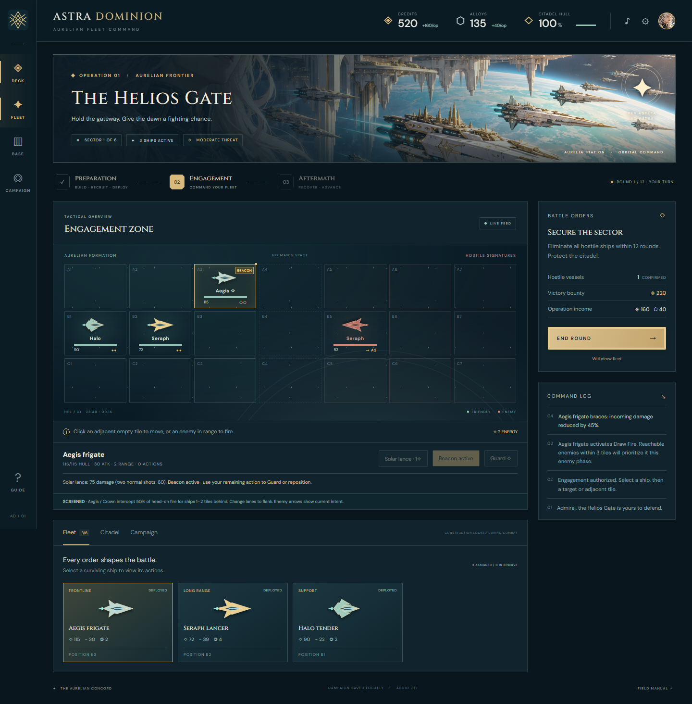

# Astra Dominion Project Handoff

Online copy: [Astra Dominion Project Handoff](https://chatgpt.com/space/page_55987f58c29081919062928631d702ca)

Astra Dominion is a playable local fleet-management and turn-based tactics game with anime-inspired art and a futuristic neo–Art Deco setting. This handoff captures the implementation, current rules, validation, and proposed narrative expansion as of October 18, 2026.

The combat and interface changes below are implemented. Campaign weeks, persistent officers, relationships, bonds, and visual-novel events remain design proposals. The next unresolved design decision is whether the player is a customizable admiral or a defined protagonist with a personal history.

This private Page provides the cross-device reference. Its downloadable project snapshot contains the actual game files. The original development folder and browser campaign saves remain local to their respective devices.

# Resume on another device

[Astra Dominion complete project snapshot](../astra-dominion-handoff-2026-10-18.zip) — 7.4 MB ZIP containing source, artwork, tests, launchers, and screenshots.

[Astra Dominion readable source bundle](../astra-dominion-source-2026-10-18.json) — 129 KB JSON with every text file, original paths, and asset checksums.

1. Download and extract the complete project ZIP attached to this Page. It contains an astra-dominion folder with the game, generated artwork, tests, and screenshots.

2. On a Windows computer with Node.js 20 or newer, double-click Play.cmd. It starts a hidden local server and opens the game. On macOS or Linux, open a terminal in the extracted folder and run npm start.

3. Open http://127.0.0.1:4173 on that same computer. This is a local address, not a public deployment.

4. To continue a played campaign, use Settings → Export campaign save on the original browser, transfer the JSON file, then use Settings → Import campaign save on the destination browser.

5. To continue development with an assistant, open this Page and provide access to the extracted source folder. The attached source JSON also exposes every text file with its original path and content for tools that can read Page attachments.

The Page and attachments travel with your account. They do not automatically synchronize a running server or browser save. The source ZIP contains no private campaign export. On a phone or tablet, this Page supports reviewing and discussing the project; playing remotely would require hosting, which has not been set up.

Original Windows project location: `C:\Users\theni\workspace\astra-dominion`.

Runtime commands:

```text
npm start
npm test
```

Browser UI verification, with the server running:

```text
node tests/browser-smoke.mjs
```

The browser check requires Playwright and installed Google Chrome. It currently finds Playwright locally or through the bundled Codex runtime on the original Windows machine; PLAYWRIGHT_PACKAGE can override that path. Runtime gameplay itself requires no npm package installation.

# Original direction and completed work

The requested experience is a streamlined military management simulation: recruit forces, build infrastructure, improve defenses, assign units during preparation, then command those deployed units in battle. The playable implementation expresses those forces as starship units. Separate ground troops and ground combat are not implemented.

The visual direction is anime-inspired super science fiction with spaceships, futuristic weaponry and uniforms, and neo–Art Deco architecture. The user explicitly rejected a cyberpunk aesthetic. The established palette is deep teal and blue-black space, ivory hulls, gold trim, geometric ornament, sunbursts, stepped towers, and restrained aquamarine engines.

Completed delivery and revisions:

- A complete six-sector campaign with preparation, engagement, and aftermath phases.

- Four recruitable ship classes, six infrastructure types, resource costs, capacity limits, upgrades, repairs, victory rewards, and defeat/recovery states.

- Turn-based movement, ordinary attacks, Guard, healing, shields, offensive abilities, and permanent ship losses.

- Generated key art, an officer portrait treatment, original SVG ship tokens and emblem, optional sound cues, and desktop/mobile layouts.

- A sticky resource navbar so credits, alloys, and citadel hull remain visible while scrolling.

- Clicking a selected ship again deselects it on either the battlefield or its fleet card, in preparation and combat.

- A separate Return to reserve command for undeploying a ship during preparation.

- Directional formation protection, flanking, stronger offensive abilities, and Draw Fire for frontline/heavy ships.

- SCREENED and BEACON markers, enemy target arrows, attack previews, and formation-aware Auto Deploy.

- Automatic browser saves, campaign import/export, save validation, and compatibility with earlier v1 campaigns.

The game remains a local single-player browser application. There is no public Site, multiplayer, user account system, real-time 3D combat, or synchronized cloud campaign storage.

# Current gameplay loop

## Preparation

Spend credits and alloys to commission ships or construct infrastructure. Select a ship from the roster or grid, then click a tile in the three friendly columns to position it. Clicking a different occupied friendly tile swaps ships. Clicking the selected ship again clears selection without changing its deployment. Return to reserve removes a selected ship from the formation.

Auto Deploy puts up to three Aegis/Crown ships at the front and fills the positions behind them before other available tiles. Reserve ships do not participate in battle.

## Engagement

The battlefield is three lanes by seven columns. Friendly ships deploy in the left three columns. Every friendly ship receives two actions per round. Movement is one orthogonal tile for one action; an ordinary attack costs one action. Weapon and healing distances count horizontal plus vertical steps.

Guard spends all remaining actions and reduces that ship’s incoming damage by 45% until the next player round. This includes damage intercepted for another ship.

The player acts with the fleet, then chooses End Round. Each enemy recalculates its plan, may move one legal tile, and fires if it has a target in range. All enemies must be destroyed within 12 rounds. Running out of time or losing the deployed fleet loses the operation. Withdraw fleet preserves survivors but incurs a failed-operation penalty.

## Aftermath

Surviving ships return at full hull for the next operation; destroyed ships are removed. Every two credited kills grants a surviving ship seven additional maximum hull.

Victory pays the sector bounty, normal operation income, and alloy salvage. Choose an additional reward of 120 credits, 55 alloys, or 25 citadel integrity, then advance. Failed operations pay reduced rewards and damage the citadel; the same sector can be retried if the citadel survives. An emergency Aegis is supplied if the entire roster has been lost.

A destroyed citadel ends the campaign. Winning the sixth sector completes it.

# Ship classes and abilities

Base values before infrastructure upgrades and veteran bonuses:

| Ship | Hull | Attack | Range | Recruitment |
| --- | --- | --- | --- | --- |
| Aegis frigate | 115 | 30 | 2 | 150 credits and 20 alloys |
| Seraph lancer | 72 | 39 | 4 | 210 credits and 35 alloys |
| Halo tender | 90 | 22 | 2 | 180 credits and 25 alloys |
| Crown cruiser | 165 | 42 | 3 | 310 credits and 65 alloys |

| Main ability | Current effect |
| --- | --- |
| Solar Lance on Aegis | 250% weapon damage. At base attack: 75 damage versus 60 from two ordinary attacks. Normal screening and Guard still apply. |
| Piercing Ray on Seraph | 230% weapon damage, bypassing Guard and formation screening. At base attack: 90 damage versus 78 from two ordinary attacks. Shields still absorb damage. |
| Restoration Field on Halo | Restores up to 38 hull to every living friendly ship within three tiles, including itself. Cannot exceed maximum hull. |
| Radiant Aegis on Crown | Adds 25 shielding to every living friendly ship. |

All main abilities cost two actions and one shared command energy, with a two-round cooldown. Command energy refills to three plus the Helios reactor level each round.

Draw Fire is an additional ability on Aegis and Crown ships, with its own cost and cooldown. It does not replace Solar Lance or Radiant Aegis. Ordinary attacks remain useful when energy is needed elsewhere, an ability is cooling down, or the ship has already moved.

# Formation protection and enemy targeting

## Screening and flanking

An Aegis or Crown can protect friendly ships one or two columns behind it in the same lane. Friendly formations face right; enemy formations face left. Protection applies when the attacker is in that same lane and fires from beyond the protector.

The protector intercepts 50% of the attack’s damage. The intended target receives the remainder. Each ship applies its own Guard and shields to its share. Both fleets use these rules.

Only the closest living protector ahead of the target intercepts. Screening does not stack or chain through multiple protectors. Moving or destroying the protector immediately changes the formation. Overkill in the intercepted share stays assigned to that protector and does not spill back to the rear ship.

An attack from another lane or from behind the protector bypasses screening. Piercing Ray also bypasses it. Other ships obstruct movement but do not block shots.

A useful formation is Halo behind Seraph behind Aegis in one lane. The Aegis protects both rear ships from head-on fire, the Seraph attacks at range, and the Halo can heal the line. Enemy attacks from another lane can still bypass the screen, so concentrating the whole fleet in one lane has a cost.

## Draw Fire

Activate Draw Fire on an Aegis or Crown for one action and one energy. It lasts through the upcoming enemy phase and ends when the next player round begins. Its separate two-round cooldown prevents immediate reuse next round.

Enemies within three tiles must prioritize the beacon if they can get into weapon range from their current tile or after one legal move. If several beacons qualify, they choose the nearest; equal-distance ties use the older ship’s ID. A dead, out-of-radius, or unreachable beacon does not stop an enemy from attacking another ship.

The beacon follows the activating ship if it moves. Its remaining action can be used to Guard, attack, or reposition. Draw Fire plus Guard is a reliable way to rescue an exposed ally while reducing the incoming damage.

## Normal enemy behavior and battlefield feedback

Without a qualifying beacon, enemies prefer the target with the lowest combined hull and shields among ships currently in range. Ties use distance, then ID. If no target is in range, they advance toward the nearest friendly ship when a legal step reduces that distance, then choose an available target.

Each enemy recalculates before acting. Displayed arrows are current intentions and can change as earlier attacks destroy ships or positions change.

SCREENED indicates potential protection against head-on fire; it does not promise protection against every attacker. BEACON identifies an active Draw Fire ship. Target tooltips show damage after Guard and screening but before shields.

# Economy infrastructure and campaign

Starting resources are 520 credits, 135 alloys, and 100 citadel integrity. The starting fleet has one Aegis, one Seraph, and one Halo. Fleet capacity starts at six. Drydocks can increase it to ten, while the deployment grid holds nine ships.

| Infrastructure | Initial cost | Effect per level | Maximum |
| --- | --- | --- | --- |
| Trade spire | 160 credits and 20 alloys | Adds 80 credits per operation | 3 |
| Stellar foundry | 130 credits and 15 alloys | Adds 25 alloys per operation | 3 |
| Aegis network | 140 credits and 35 alloys | Adds 15 starting shields to each deployed ship | 3 |
| Orbital drydock | 200 credits and 40 alloys | Adds two roster slots and reduces recruit credit costs by 8% of base cost | 2 |
| Photon arsenal | 190 credits and 45 alloys | Adds 15% of base weapon damage | 3 |
| Helios reactor | 150 credits and 30 alloys | Adds one command energy per round | 2 |

Each further construction level costs an additional 70 credits and 15 alloys. Drydock discounts affect credit costs, not alloy costs. Upgrade effects are additive by level.

Base operation income is 160 credits and 40 alloys, paid after wins and failures. Victory adds the sector bounty and 25 alloys. Failure adds 60 credits and 10 alloys. A failed operation damages the citadel by 18 plus four for each remaining hostile ship.

Citadel repair costs 90 credits and 20 alloys and restores up to 30 integrity. It is available during preparation.

| Sector | Enemy vessels | Victory bounty |
| --- | --- | --- |
| The Helios Gate | 3 | 220 credits |
| The Ivory Belt | 4 | 270 credits |
| Meridian Crossing | 4 | 320 credits |
| The Silent Basilica | 5 | 370 credits |
| Eclipse Anchorage | 5 | 420 credits |
| The Last Sun | 6 | 600 credits |

All six current mission objectives are to eliminate the enemy fleet within 12 rounds. More varied mission types were discussed as a future extension.

Early economic investment supports later recruitment, while fleet-wide shield and weapon upgrades become more valuable as the fleet grows. Focus fire removes enemy actions. Preserve durable screens, heal nearby allies, flank hostile formations, and use Draw Fire to protect ships outside a screened line.

# Implementation and source files

The application uses buildless HTML, CSS, and JavaScript ES modules. The local static server uses Node’s built-in modules and binds only to 127.0.0.1. PORT can override its default port of 4173. Optional Google Fonts have system fallbacks; gameplay and the included art are local.

| Path inside the project | Purpose |
| --- | --- |
| dist/index.html | Browser entry point and metadata |
| dist/engine.js | Economy, deployment, combat, targeting, screening, abilities, campaign state, and save validation |
| dist/app.js | Rendering, contextual controls, target previews, dialogs, browser persistence, and sound |
| dist/style.css | Neo–Art Deco styling, sticky resources, responsive layout, and reduced-motion support |
| dist/assets/aurelia-key-art.png | Generated anime-inspired key art, also framed as the officer portrait |
| dist/assets/emblem.svg | Original vector emblem |
| server.mjs | Local static HTTP server |
| Play.cmd and Play.ps1 | Windows launcher and server-readiness checks |
| package.json | Start and test commands |
| tests/engine.test.mjs | Automated game-rule and full-campaign tests |
| tests/browser-smoke.mjs | Isolated Chrome interaction and responsive-layout checks |
| screenshots | Desktop, mobile, victory, sticky-navbar, and tactical UI captures |
| README.md | Local operating instructions and current game rules |
| ART-DIRECTION.txt | Artwork provenance and exact generation prompt |

Important engine entry points include recruit, build, repair, deploy, reserve, autoDeploy, startBattle, move, attack, support, guard, screenFor, previewDamage, drawFire, enemyPlan, enemyStep, nextRound, finish, continue, serialize, and restore.

The save schema remains version 1. New taunting and tauntCooldown fields are initialized when older saves load. The browser storage key is astra-dominion-save-v1. Saves are per browser and origin. Mid-enemy-phase persistence is deferred so an interrupted animation resumes from the last saved player-turn state.

The snapshot contains 24 project files. Server logs, the local process ID file, Git metadata, and dependency folders are excluded. The attached source JSON contains all text files and binary-asset checksums. The full ZIP contains the binary artwork and screenshots too.

# Artwork and interface details



Tactical view of the implemented game, including Draw Fire controls. The archive contains desktop and mobile screenshots.

The key illustration was generated with the built-in image generation tool and copied into the project. It depicts an adult silver-haired fleet officer, ivory-and-gold orbital citadel, elegant starships, and a pale turquoise planet. The command banner and Lyra Voss advisor card use different CSS framings of the same image.

The ship tokens and emblem are editable SVG graphics in the source. The exact generation prompt is included in ART-DIRECTION.txt and in the source bundle.

The interface includes a resource header, phase indicator, tactical grid, fleet roster, recruitment controls, citadel and campaign tabs, mission brief, command log, field manual, settings, and victory/defeat dialogs. A fixed mobile End Round control keeps combat progression accessible.

Sound cues start muted. Keyboard support includes Tab and Enter for controls and Escape to close a dialog or cancel ability targeting. Focus indicators, battlefield labels, dialog focus trapping, and reduced-motion handling are present.

Lyra Voss is currently a static advisor presentation. Persistent officers, assigned captains, relationship values, bond progression, and VN scenes are not implemented.

# Verification and current limits

The latest completed validation reported 24 passing engine tests, including a complete six-sector campaign using legal actions and upgrades.

Coverage includes economy and capacity limits; deployment and reserves; movement, range, actions and Guard; healing and cooldowns; victory, retreat, emergency recovery and defeat; save roundtrips; directional and mirrored screening; flanking; independent Guard/shield mitigation; non-stacking interception; offensive ability damage; Piercing Ray bypasses; destroyed protectors; Draw Fire redirection, reachability, competing beacons, expiry and cooldown; legacy-save migration; and formation-aware Auto Deploy.

Browser checks passed for sticky resources on desktop/mobile, deselection in preparation/combat, explicit reserve controls, recruitment, deployment, construction, attacks, Guard, enemy turns, save/reload, retreat, restart, victory rewards, campaign progression, the guide, screening, Draw Fire targeting and expiry, and Piercing Ray damage. The checks reported no JavaScript errors and no mobile horizontal overflow. Desktop/mobile screenshots were visually inspected.

The campaign is a first playable version. It has a small board, deterministic enemy decisions, and limited mission variety. Enemies use normal movement and attacks; they do not yet activate their own special abilities. Passing tests establish behavior and campaign completion, not a final balance assessment.

There is no hosted playable URL. Documentation and source attachments are available through this Page, while local runtime access and campaign-save transfer are separate.

# Story and relationship expansion under discussion

The user expressed interest in expanding the combat deeply and adding story, player turns, character relationships, bonds, and VN-styled narrative events. These are proposed directions, not completed features or a finalized implementation request.

The proposed larger loop is: briefing → command decisions → crew scenes → deployment → battle → consequences.

## Campaign turns

Interpret player turns as campaign days or weeks above combat rounds. Give each turn a limited number of command actions so construction, training, diplomacy, recovery, and time with officers compete for attention.

Income, construction progress, injuries, and enemy advances could resolve at campaign-turn boundaries. This would require revisiting the current operation-based economy, including rewards for repeated failed operations, so time and scheduling have meaningful costs.

## Story and officers

Use mission choices with competing priorities, such as rescuing a stranded crew, defending a convoy, or capturing a foundry. Choices can change resources, future encounters, and officer reactions.

Assign persistent officers to ships. Their specialties, convictions, and command styles can influence both combat and story. A proposed loss model makes hulls expendable while leaving a captain injured, stranded, or captured, creating recovery or rescue decisions. Permanent character death was suggested as a possible explicit difficulty option once the narrative supports it.

## Relationships and bonds

Track an officer’s trust in the commander separately from bonds between officers. Shared deployments, protecting someone, disagreements, and resolved conflicts can advance these relationships.

Bonds should primarily unlock tactical options, with restrained numerical bonuses. An example is Covering Advance: once per battle, a lancer can follow its protector one tile without spending an action. That ability is only a design example and has not been added.

A possible event starts when a frigate captain repeatedly uses Draw Fire to save a lancer. A debrief explores whether the lancer sees that as trust or excessive supervision. Resolving the conflict could unlock their coordinated maneuver.

## Visual novel events

Use short illustrated scenes triggered by campaign choices and combat outcomes. Dialogue choices should affect later scenes or decisions. A dialogue log, clear pacing controls, and opportunities to pause or skip would help preserve the streamlined combat loop.

A shared main story with conditional scenes and a few consequential branches was proposed to limit writing and testing complexity. Mandatory long scenes after every battle and a fully separate storyline for every pairing would increase scope quickly.

## Suggested first expansion

The suggested first slice is four officers, three campaign weeks, several conditional crew scenes, and two bond abilities. Its purpose is to test whether the narrative and combat strengthen one another before expanding the cast or branching structure.

The main open question remains: should the player be a customizable admiral, or a defined protagonist with a personal history? Other open decisions include turn length and action budget, narrative tone, officer-loss consequences, relationship dimensions, bond triggers, mission variety, and the scope of the first narrative arc.

# Continue the project

Preserve the anime-inspired neo–Art Deco direction, the working preparation/battle/aftermath loop, sticky resource access, consistent deselection, explicit reserves, directional screening, Draw Fire, and the strengthened offensive abilities. Preserve existing saves when adding new state.

For the next design conversation, resolve the player protagonist choice and agree on the first narrative slice before building the story system. The story proposals above have not been accepted as a final specification.

For the next implementation session, obtain the source snapshot, inspect the current files, and run the relevant existing checks. Use the snapshots as the handoff baseline and confirm any changes made after October 18, 2026.

```codex-prompt
Continue the Astra Dominion project using this handoff and its attached source snapshot. Begin by separating implemented mechanics from the proposed story expansion. Preserve existing saves and the neo–Art Deco art direction. The unresolved design question is whether the player is a customizable admiral or a defined protagonist. Help me settle that choice and shape a small first narrative expansion before changing the story systems.
```

